<div align="center">

# CodeShare

**Real-time collaborative coding rooms. Write, run and visualize code together, practice interview problems, run live mock interviews, and play coding games with friends, all in the browser.**

[](https://codeshare.tech)


<br />

<picture>
  <source media="(prefers-color-scheme: dark)" srcset="docs/readme/hero-dark.jpg" />
  <source media="(prefers-color-scheme: light)" srcset="docs/readme/hero-light.jpg" />
  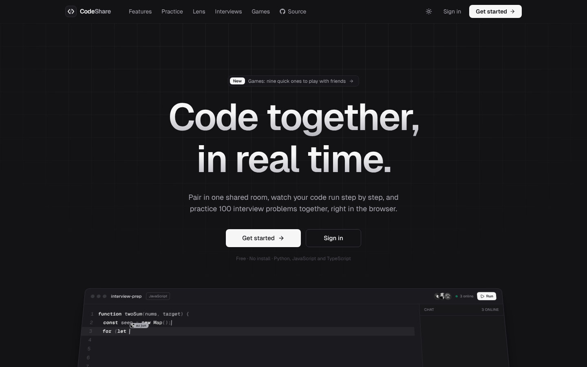
</picture>

**[Try it live →](https://codeshare.tech)** · [Tour](#a-quick-tour) · [Games](#games) · [Features](#features) · [How it works](#how-it-works) · [Run it locally](#run-it-locally) · [API](#api-reference)

</div>

<br />

| **100** | **596** | **40** | **9** | **3** | **8** |
|:---:|:---:|:---:|:---:|:---:|:---:|
| practice problems | test cases | Lens concepts | multiplayer games | languages you can run | editor themes |

---

## Overview

CodeShare is a real-time collaborative coding platform. Everyone in a room types in the same file at the same time, and every edit merges cleanly, with live cursors, presence and a built-in chat. Code runs right in the browser in a locked-down sandbox (JavaScript, TypeScript and Python). On top of that sit:

- **Lens**, which replays a run line by line and draws every variable, list, linked list and tree.
- **Hotspots**, which shows how often every line ran.
- A **Big-O meter** that measures your function's complexity as you type.
- A **Practice** library of 100 interview problems with real tests.
- **Interviews**: a lobby, a timer, a ladder of hints, shared notes and scorecards.
- **Nine games** to play alone or with friends.

I built it one feature at a time as a portfolio project, favouring decisions I can explain over sheer feature count.

### Try it in a minute

1. Open **[codeshare.tech](https://codeshare.tech)** and sign up with your email.
2. Create a room, copy its invite link and open it in a second browser window. Type in one and watch it appear in the other, even when you type in both at once.
3. Press <kbd>⌘</kbd> <kbd>↵</kbd> (<kbd>Ctrl</kbd> <kbd>Enter</kbd> on Windows) to run the code. Everyone in the room sees the output.
4. Press **Visualize** to watch it run step by step, or **Hotspots** to see where the time goes.
5. Open **Games** and play one right away. Playing solo doesn't even need an account.

## A quick tour

### Code together, live

<p align="center">
  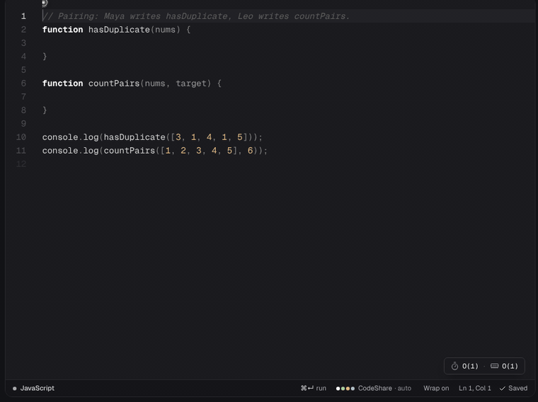
</p>

<p align="center"><sub>Maya and Leo type in the same file at the same moment. Both edits merge, Leo's cursor shows where he is, and once his nested loop is done the Big-O meter reads <b>O(n²)</b>.</sub></p>

<p align="center">
  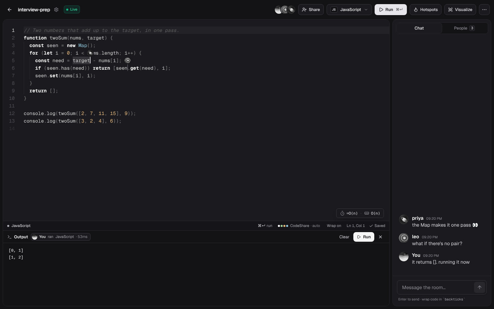
</p>

<p align="center"><sub>A room with three people: live cursors and selections, chat, the shared run output and the Big-O meter.</sub></p>

### Watch your code run (Lens)

<p align="center">
  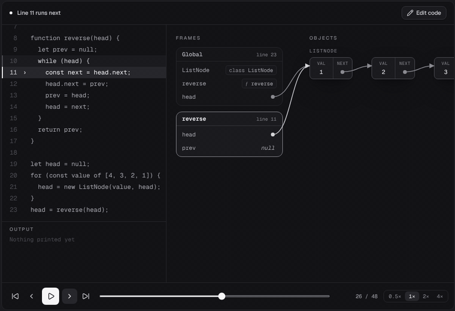
</p>

<p align="center"><sub>Reversing a linked list, one line at a time. Every frame, variable and pointer is drawn as it changes.</sub></p>

### See where the time goes (Hotspots)

<p align="center">
  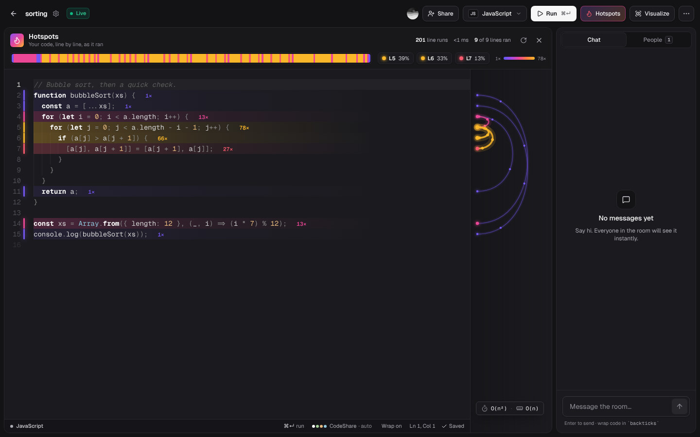
</p>

<p align="center"><sub>Hotspots colors every line by how often it ran (with counts), draws arcs for the jumps between lines, and lays the whole run out as a timeline.</sub></p>

### Practice interview problems together

<table>
  <tr>
    <td width="50%">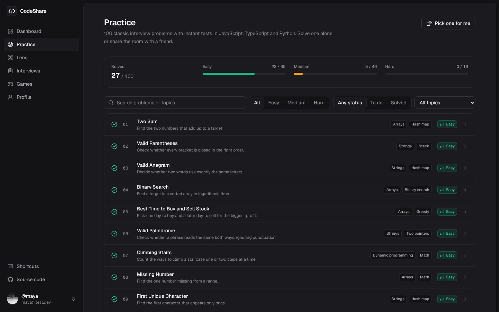</td>
    <td width="50%">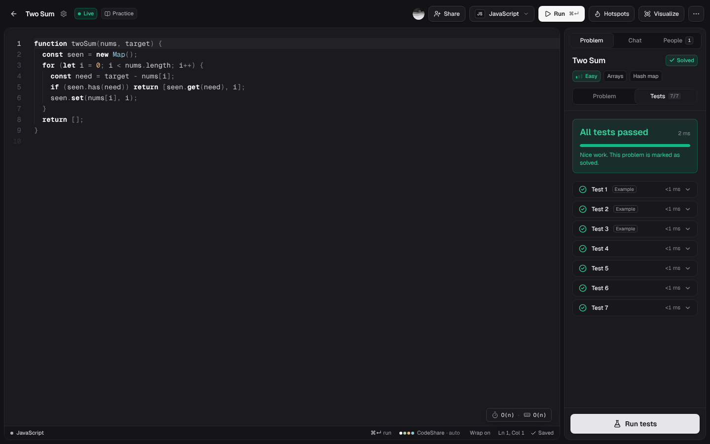</td>
  </tr>
  <tr>
    <td align="center"><sub>100 problems, progress by difficulty, filters and search.</sub></td>
    <td align="center"><sub>Run the tests in the room: all 7 pass, and the problem is marked solved.</sub></td>
  </tr>
</table>

### Run real interviews

<p align="center">
  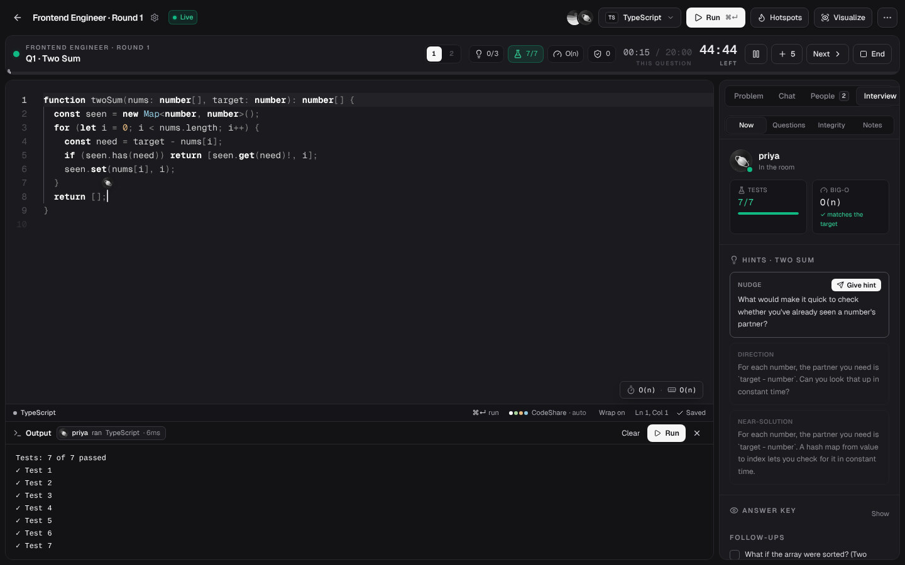
</p>

<p align="center"><sub>The interviewer's view during a live interview. Priya's code, her 7/7 tests and an O(n) reading that matches the target, the three-step hint ladder, the clock, the answer key and follow-ups.</sub></p>

<details>
<summary><b>Setting one up</b></summary>
<br />
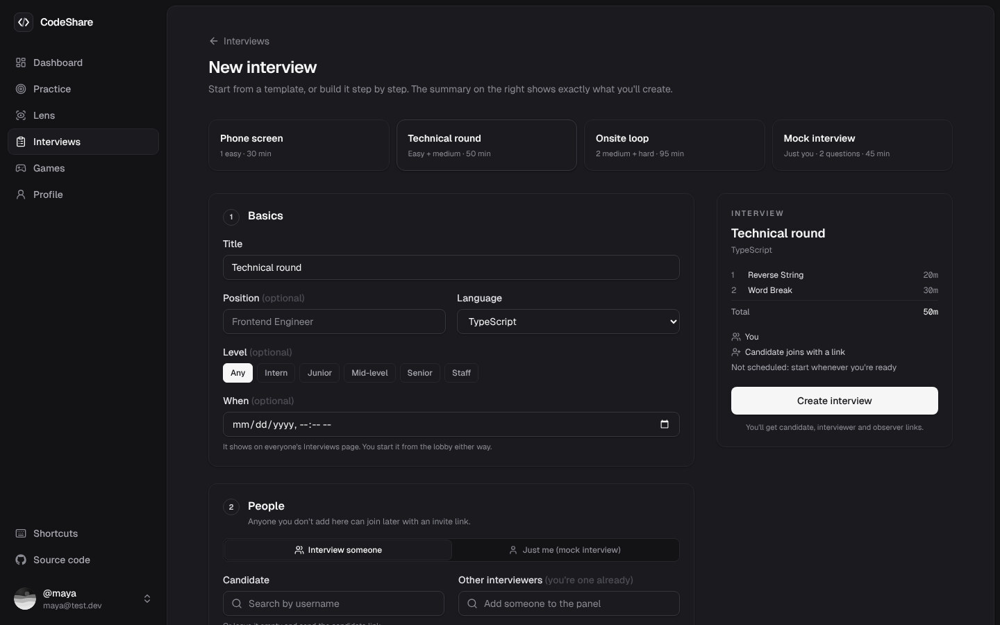
</details>

### Your dashboard

<p align="center">
  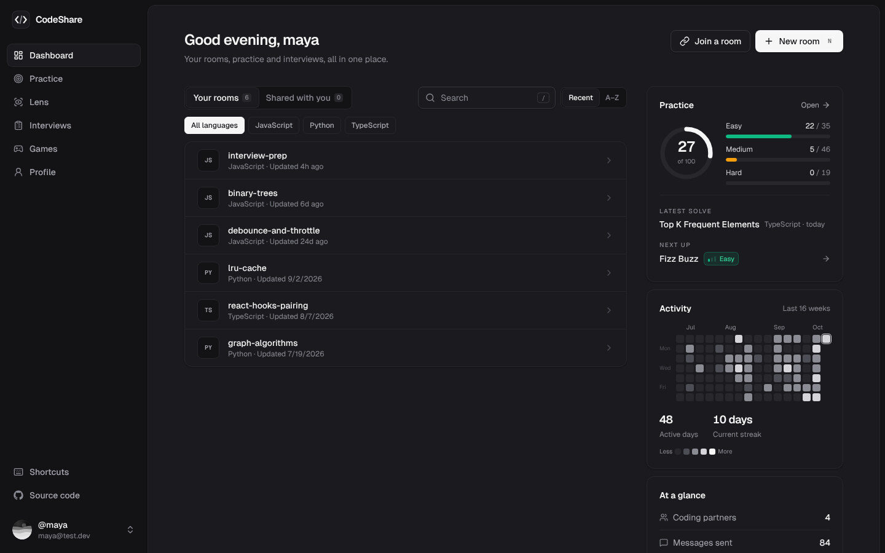
</p>

<p align="center"><sub>Your rooms, practice progress, a 16-week activity map, your streak and the people you've coded with.</sub></p>

### On your phone

<p align="center">
  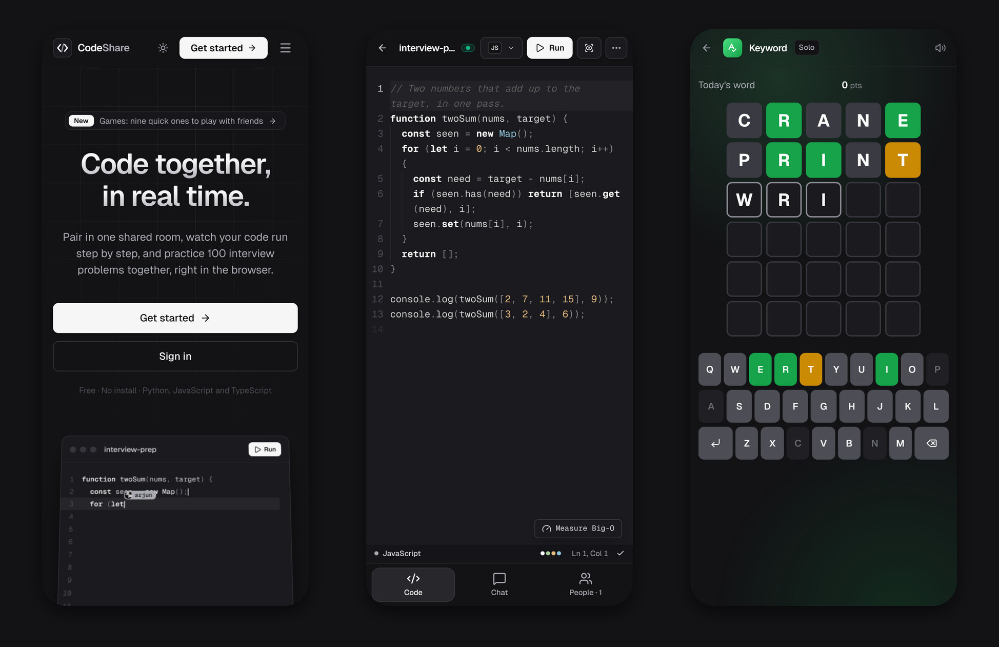
</p>

## Games

**Nine quick games for people who code.** Play solo in seconds, with no account needed. Or open a lobby, share the 6-character code or link, and play live with friends: emoji reactions, a podium with confetti, and a rematch button.

<p align="center">
  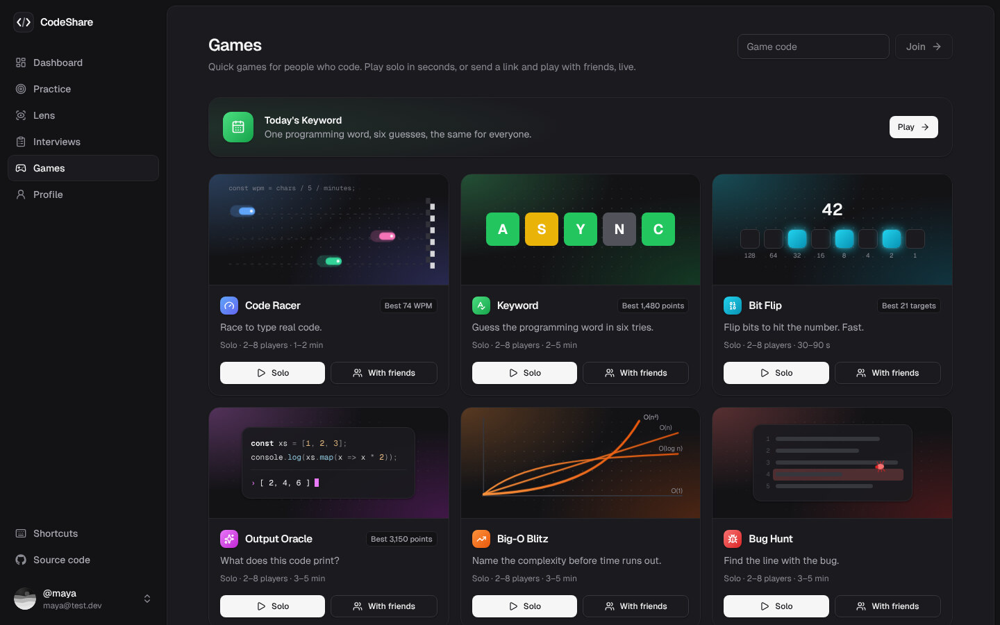
</p>

<table>
  <tr>
    <td align="center" width="33%"><b>Keyword</b><br /><sub>Guess the programming word in six tries</sub></td>
    <td align="center" width="33%"><b>Byte Snake</b><br /><sub>Eat bytes, grow long, don't crash</sub></td>
    <td align="center" width="33%"><b>Four in a Row</b><br /><sub>Drop discs, connect four</sub></td>
  </tr>
  <tr>
    <td>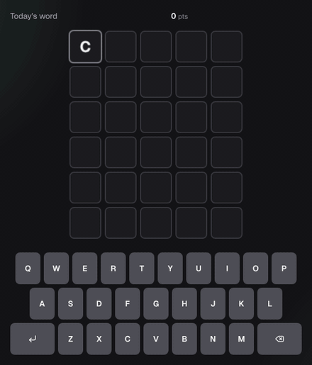</td>
    <td>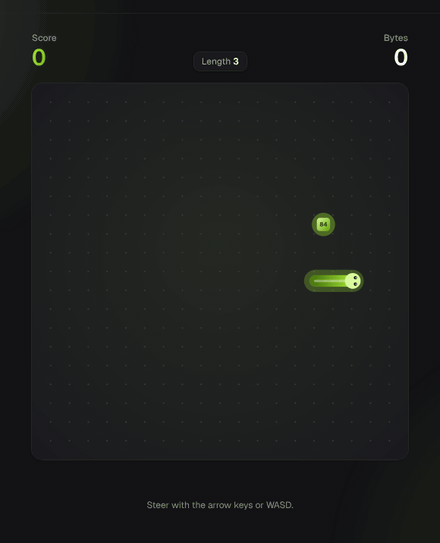</td>
    <td>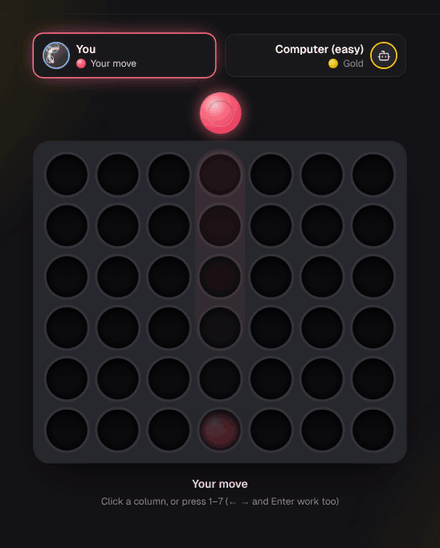</td>
  </tr>
</table>

<table>
  <tr>
    <td align="center" width="50%"><b>Code Racer</b><br /><sub>Race to type real code</sub></td>
    <td align="center" width="50%"><b>Pair Programming</b><br /><sub>Match coding concepts from memory</sub></td>
  </tr>
  <tr>
    <td>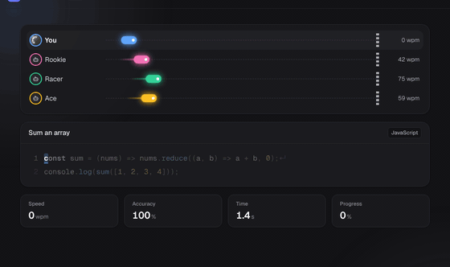</td>
    <td>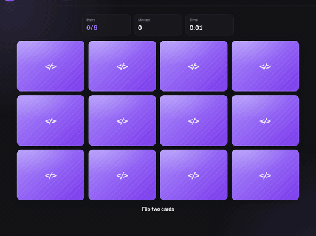</td>
  </tr>
  <tr>
    <td align="center"><b>Bit Flip</b><br /><sub>Flip bits to hit the number. Fast.</sub></td>
    <td align="center"><b>Output Oracle</b><br /><sub>What does this code print?</sub></td>
  </tr>
  <tr>
    <td>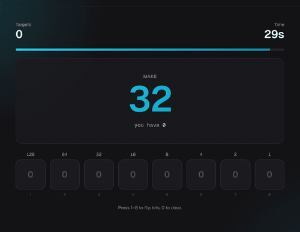</td>
    <td>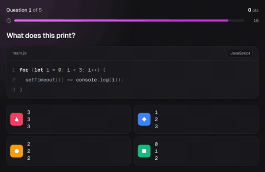</td>
  </tr>
  <tr>
    <td align="center"><b>Big-O Blitz</b><br /><sub>Name the complexity before time runs out</sub></td>
    <td align="center"><b>Bug Hunt</b><br /><sub>Find the line with the bug</sub></td>
  </tr>
  <tr>
    <td>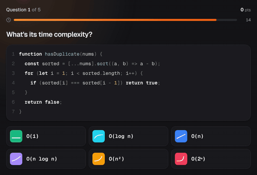</td>
    <td>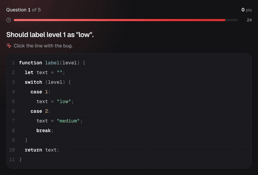</td>
  </tr>
</table>

### Playing with friends

<p align="center">
  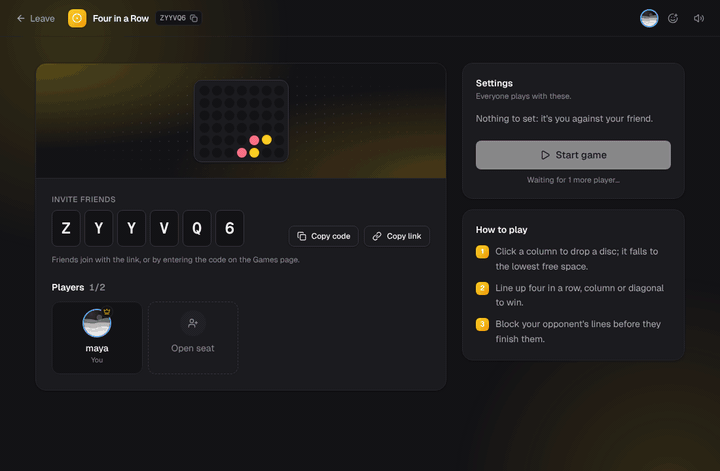
</p>

<p align="center"><sub>Maya opens a lobby and Leo joins with the code. They play live, Leo reacts 🔥, and the podium crowns the winner.</sub></p>

| Game | What you do | Players | Inside |
|---|---|---|---|
| **Code Racer** | Type a real snippet as fast as you can, against friends or three computer racers | Solo or 2–8 | 45 snippets in JavaScript, TypeScript and Python |
| **Keyword** | Guess the 5-letter programming word; green is right, yellow is elsewhere | Solo or 2–8 | 173 answers, plus a daily word that's the same for everyone |
| **Bit Flip** | Switch eight bits on and off until they add up to each number, in decimal or hex | Solo or 2–8 | Combos for targets hit back to back |
| **Output Oracle** | Read a snippet and pick what it prints | Solo or 2–8 | 44 snippets, every answer checked by running it |
| **Big-O Blitz** | Name each snippet's time complexity | Solo or 2–8 | 32 snippets, from O(1) to O(2ⁿ) |
| **Bug Hunt** | Click the line with the bug, then see the fix | Solo or 2–8 | 29 snippets, every bug and fix checked by running both |
| **Four in a Row** | Drop discs and connect four | Against the computer (3 levels) or 1 vs 1 | 30-second turns with friends |
| **Pair Programming** | Flip two cards at a time to match things that belong together | Solo or 2–4 | 59 pairs, like `404` and Not Found |
| **Byte Snake** | Steer a snake to eat bytes; with friends, everyone shares one board | Solo or 2–8 | Arrow keys, WASD or swipes |

## Features

### Collaborate in real time
- **Conflict-free editing.** The room's code is a shared [Yjs](https://yjs.dev) document, so edits typed at the same moment merge instead of overwriting each other. <kbd>⌘</kbd> <kbd>Z</kbd> only undoes your own edits.
- **Live cursors and Follow mode.** See everyone's cursor and selection, and follow a teammate to ride along with them.
- **Roles and invite links.** The owner runs the room; editors can change the code; viewers can watch, follow and chat. There are separate edit and view-only invite links, and a viewer can ask the owner for edit access.
- **Shared runs.** Language changes and run results are broadcast to everyone, labelled with who ran the code.
- **Chat in every room.** It's persistent, with message grouping, avatars, a typing indicator, emoji reactions and an unread badge. Right-click selected code to send it to chat as a code block.

### Run code in the browser
- **Three languages.** JavaScript, TypeScript and Python (3.14, via Pyodide) run client-side in an isolated sandbox, with no server cost and no access to the app.
- **Runaway code is stopped.** Infinite loops are ended after 5 s (JavaScript and TypeScript) or 10 s (Python), and the next run works immediately.
- **Clear output.** Errors come with line numbers, `console.log` and `print` output is captured, and output is capped at 20,000 characters.

### Lens: watch your code run
- **Step through any run.** Lens records a Python, JavaScript or TypeScript program (up to 1,000 steps) and replays it line by line. It draws every frame and variable, with arrays, maps, linked lists and trees shown as they change.
- **40 ready-made concepts.** Sorting, two pointers, stacks, heaps, trees, graphs, backtracking and dynamic programming, from binary search to Dijkstra.
- **Together.** In a room, one person drives and everyone follows the same step live. Anyone can take control.

### Hotspots and the Big-O meter
- **Hotspots.** Run your code wrapped in a line counter to see how many times every line ran, the busiest jumps between lines, and a timeline of the whole run. In Practice rooms, it runs on one big input, so the heat shows where the work grows.
- **Big-O meter.** A badge over the editor shows your function's time and space complexity, like `O(n log n) · O(n)`. It's measured, not guessed: the function runs on inputs that keep growing and the curve is fitted, so it also catches hidden costs like `x in list` inside a loop. Rough readings are marked with ≈, and code too slow to measure says "Too slow" instead of guessing.

### Practice interview problems together
- **100 problems** (35 Easy, 46 Medium, 19 Hard) across 22 topics, with **596 test cases**.
- **Solve in a room.** Pick a problem and a language, and CodeShare opens a room with starter code, a Problem tab and the tests. Work alone, or share the link and solve it together.
- **Correct judging.** Linked lists and binary trees are real `ListNode` / `TreeNode` objects. In-place problems and "any order" answers are judged correctly.
- **Progress tracking.** Solved problems, per-difficulty progress, filters by topic, difficulty and status, and "continue where you left off". Practice rooms stay off your dashboard.

### Interviews
- **Plan it.** Start from a template (phone screen, technical round, onsite loop, mock interview) or build your own: questions from the 100-problem library or your own, time per question, the language, and who's on the panel.
- **Run it live.** Candidate, interviewer and observer links, a lobby, a 3-2-1 countdown, and one question at a time on a clock you can pause or extend.
- **Interviewer tools.** A three-step hint ladder for every library problem (nudge, direction, near-solution), an answer key with the target complexity, follow-up questions and shared notes. Everything the candidate does is stamped in interview time: test runs and Big-O readings, recorded with the code at that moment.
- **Optional monitoring, always visible.** Tab switches, pastes, large insertions, second tabs and dropped connections can be recorded. The candidate is told before it starts.
- **Decide together.** Every interviewer fills in their own scorecard, and the report keeps each question's code, time, tests and every scorecard.

### Games
- **Nine games, two ways to play.** Solo works without an account. With friends, you get a lobby, a code and a link, live play, reactions, a podium and a rematch.
- **Fair results.** Every browser reports the final standings, and a result only counts when they all agree. Wins only come from games with friends.
- **Bests and leaderboards.** Personal bests for every game, a leaderboard for each, and a daily Keyword that's the same for everyone.

### Dashboard and profiles
- **Dashboard.** Create, search, sort, filter by language and delete rooms. See practice progress, a 16-week activity map, your streak and the people you've coded with.
- **Profiles.** A 3-step onboarding (username, avatar, bio) and a profile page with your favourite language, GitHub handle and stats.

### Polish
- **Editor comfort.** 8 editor themes, word wrap, font-size controls, one-click formatting with Prettier, download and copy, a resizable sidebar and focus mode.
- **Dark first, light too.** A soft-charcoal dark theme by default, and a full light theme.
- **Works everywhere.** Responsive down to phones (tabbed room layout), with visible focus rings, a skip-to-content link and full `prefers-reduced-motion` support.

**Keyboard-first** (<kbd>⌘</kbd> on Mac, <kbd>Ctrl</kbd> on Windows and Linux):

| Shortcut | What it does |
|---|---|
| <kbd>⌘</kbd> <kbd>K</kbd> | Command palette |
| <kbd>⌘</kbd> <kbd>↵</kbd> | Run code |
| <kbd>N</kbd> | New room |
| <kbd>/</kbd> | Search rooms |
| <kbd>?</kbd> | Show every shortcut |
| Right-click | Send selected code to chat |

## How it works

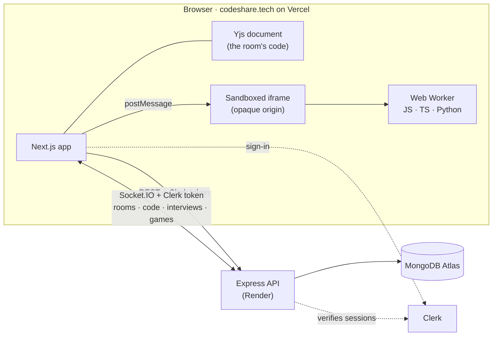

### What happens when you press Run

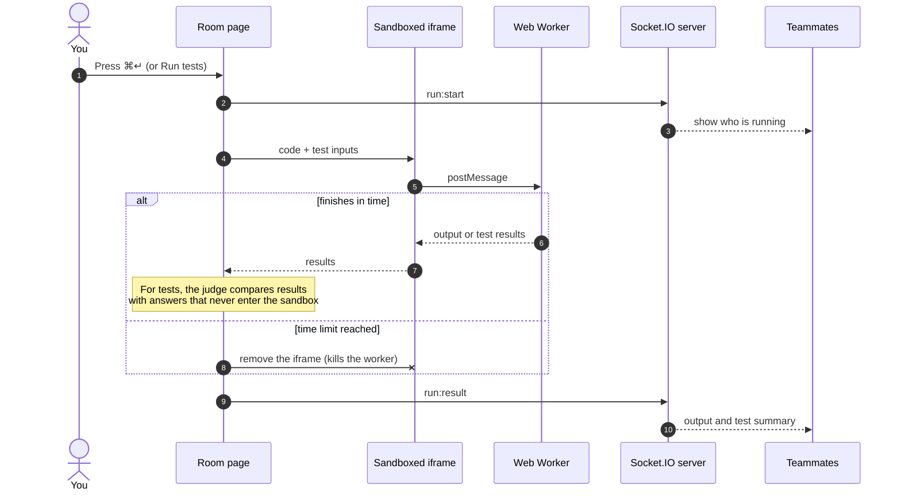

- **Isolation.** Code runs in a hidden iframe with `sandbox="allow-scripts"` and **no** `allow-same-origin`. That gives it an opaque origin, so it can't read the app's cookies, storage, session or page.
- **Hard time limits.** Inside the frame, code runs in a Web Worker. Limits are enforced from outside: if a run doesn't finish in time, the iframe is removed, which kills the worker. `while (true) {}` can never freeze the tab.
- **JavaScript and TypeScript.** JavaScript gets a fresh sandbox for every run. TypeScript's type annotations are stripped in the browser with Babel first.
- **Python.** Python runs on **Pyodide 314**, CPython 3.14 compiled to WebAssembly. It's downloaded on first use and kept warm between runs.
- **A subtle bug.** Pyodide only runs in *module* workers, and Chrome won't start a module worker from a `blob:` URL inside an opaque-origin frame. The Python worker is therefore started from a `data:` URL, which also gets its own separate origin.
- **Lens, Hotspots and the Big-O meter** all reuse the same sandbox. Lens wraps the program in a tracer that records every step, Hotspots wraps it in line counters, and the meter times the function on inputs that keep growing.

### How live editing works

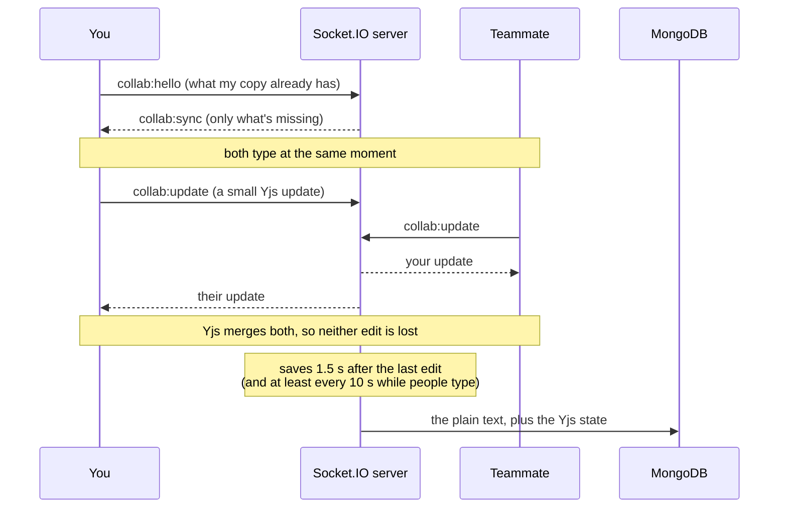

- **One shared document per room.** Each browser keeps a copy of the room's Yjs document. Edits become small updates that the server merges and passes on, so edits made at the same moment are combined.
- **Reconnecting is safe.** Joining starts with a handshake in which each side sends only what the other is missing, so edits made while offline merge in too. The server saves the Yjs state as well as the text, so people who reconnect after a restart merge into the same history instead of duplicating it.
- **Presence and cursors.** Cursors and selections travel as Yjs awareness updates. Each room's presence list lives in memory on the server and is broadcast whenever someone joins or leaves.
- **Validated and bounded.** Every event payload is validated, room events are only accepted from sockets that joined that room, viewers can't edit, and a room's code is capped at 100,000 characters.

### How games stay in sync

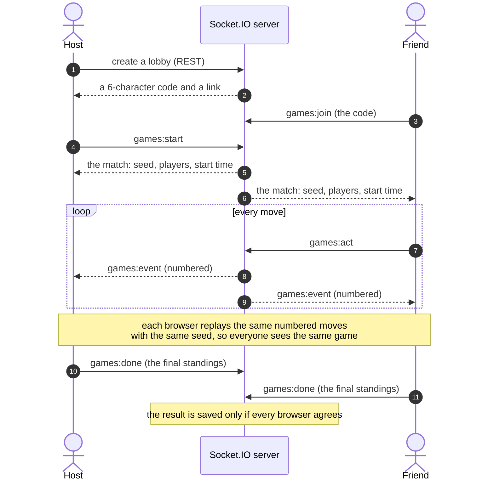

- **An ordered list of moves.** The server doesn't run the games. It gives each match a seed and keeps one numbered list of moves. Every browser runs the same rules over the same list, so all of them show the same board, scores and winner. Your own moves show at once and are matched up when the server's copy arrives.
- **Clock games settle fairly.** Games that end on the clock wait a moment for moves still on their way, and moves after the end are ignored, so every browser computes the same standings.
- **Results nobody can fake alone.** Each browser reports the final standings, and the server only records a result when every player's browser agrees.
- **Dropping out.** A player who loses connection has 45 seconds to come back. Lobbies, moves and messages are all capped, and old lobbies are swept away.

### The Practice judge
- **Problems are data.** Each one declares typed parameters (like `int[]`, `list` or `tree`), a return type and test cases. Starter code for all three languages is generated from those types, including `ListNode` / `TreeNode` classes where needed.
- **Answers stay outside the sandbox.** Only the inputs go in. The judge compares results outside, with exact and order-insensitive modes (for example, "return all permutations in any order").
- **Lists and trees.** They travel as arrays (LeetCode style), are rebuilt into real nodes inside the sandbox, and are read back afterwards. Cycle detection turns a broken list into a clear error instead of a hang.
- **Verified test data.** Every test case was checked against two independent reference solutions, one in JavaScript and one in Python.
- **Atomic progress.** Solving a problem is recorded with a single atomic MongoDB update, so a double submit can never count twice.

### Auth and security
- **Route protection.** Clerk handles sign-up and sign-in. `proxy.ts` (Next.js 16 middleware) protects the dashboard, rooms, profiles, onboarding, interview pages and online game lobbies before any page code runs. Games stay public to play solo.
- **The backend never trusts the frontend.** Every API route re-verifies the Clerk session from the `Authorization: Bearer` header, and sockets authenticate in the handshake with the same token. The app and API live on different origins, so auth uses tokens, not cookies.
- **Server-side rules.** Roles are enforced on the server: only the owner can rename, delete or change roles, and only editors can change code. Inputs are validated, including room names, code size, usernames, problem slugs and language allowlists.
- **Invite links.** Room ids are database ids, which can be predicted (they contain a timestamp and a counter), so an id alone opens nothing. People join with the room's edit or view-only invite link. Each carries a random 16-character code (about 95 bits), and people are remembered after that.
- **Rate limits.** Every API route and every live event has a per-person rate limit (kept in memory, with no extra service). Each person can own up to 100 rooms, and game lobbies are capped per host, so a script can't flood a room or fill the database.
- **Locked-down API.** CORS only accepts an allowlist of site origins, and Helmet sets security headers.

### Keeping a free deployment fast
- **No cold starts.** The API runs on Render's free tier, which sleeps after 15 idle minutes and takes about a minute to wake. An uptime monitor pings it every 5 minutes, so visitors don't hit a cold start.
- **Faster sign-up.** New sign-ups go straight to onboarding instead of bouncing through the dashboard, which saves a round trip to the server.

## Tech stack

<p align="center">
  <a href="https://skillicons.dev">
    
  </a>
</p>

| Layer | Technologies |
|---|---|
| Frontend | Next.js 16 (App Router), React 19, TypeScript, Tailwind CSS v4, Framer Motion, Lenis, Lucide |
| Editor | Monaco Editor, Prettier |
| Real-time | Socket.IO, Yjs (conflict-free shared editing) |
| Code execution | Sandboxed iframes, Web Workers, Babel (TypeScript), Pyodide (Python) |
| Backend | Node.js, Express 5, TypeScript |
| Database | MongoDB Atlas, Mongoose |
| Auth | Clerk |
| Hosting | Vercel (frontend), Render (API), MongoDB Atlas (database), UptimeRobot (keep-alive) |

## Project structure

<details>
<summary><b>Show the folder tree</b></summary>

```text
codeshare/
├── client/                        # Next.js 16 app → Vercel
│   ├── app/
│   │   ├── page.tsx               # landing page
│   │   ├── dashboard/             # your rooms, progress, activity
│   │   ├── room/[id]/             # the collaborative room
│   │   ├── practice/              # problem library and problem pages
│   │   ├── lens/                  # Lens and its 40 concepts
│   │   ├── interviews/            # plan, join and review interviews
│   │   ├── games/                 # the games, solo and with friends
│   │   ├── onboarding/, profile/  # profile setup and profile page
│   │   ├── sign-in/, sign-up/     # Clerk
│   │   ├── template.tsx           # page transitions
│   │   └── opengraph-image.tsx    # link-preview card
│   ├── components/                # CodeEditor, ChatPanel, RunPanel, ComplexityMeter,
│   │                              #   landing/, lens/, hotspots/, interview/, games/, …
│   ├── lib/
│   │   ├── collab.ts              # Yjs shared editing (client side)
│   │   ├── execution.ts           # sandbox lifecycle, time limits, test reports
│   │   ├── sandboxRunners.ts      # code that runs inside the sandbox
│   │   ├── judge.ts               # compares results (exact or order-insensitive)
│   │   ├── problems.ts            # practice problems and starter-code generator
│   │   ├── lens*.ts               # Lens: recording and replaying runs
│   │   ├── hotspots*.ts           # Hotspots: line counts and the run's timeline
│   │   ├── complexity*.ts         # Big-O meter: measuring growth and fitting curves
│   │   ├── interview*.ts          # Interviews: the clock, hints, monitoring
│   │   ├── games/                 # the games' rules, content, lobby and sounds
│   │   ├── socket.ts              # Socket.IO client
│   │   └── api.ts                 # authenticated REST client
│   └── proxy.ts                   # Clerk route protection (Next.js 16 middleware)
├── server/                        # Express API + Socket.IO → Render
│   └── src/
│       ├── server.ts              # app setup, CORS, Clerk, routes, graceful shutdown
│       ├── routes/                # rooms, profile, interviews, games
│       ├── controllers/           # rooms, people, messages, profiles, interviews, games
│       ├── models/                # Room, Message, Profile, Interview, GameScore
│       ├── sockets/               # presence, chat, runs, Lens · collab (Yjs) · interview · games
│       ├── middleware/            # requireAuth, errorHandler
│       ├── lib/                   # access and roles, invite links, rate limits, games
│       └── config/db.ts           # MongoDB connection
└── package.json                   # `npm run dev` starts both apps
```

</details>

## API reference

Every route except the health check requires a signed-in user (`Authorization: Bearer <Clerk token>`).

<details>
<summary><b>REST: rooms, people and profiles</b></summary>

**Rooms**

| Method | Route | Description |
|---|---|---|
| `GET` | `/` | Health check |
| `POST` | `/api/rooms` | Create a room (optionally with starter code and a practice problem) |
| `GET` | `/api/rooms` | Your rooms (practice rooms excluded) |
| `GET` | `/api/rooms?problem=<slug>` | Your rooms for one practice problem |
| `GET` | `/api/rooms/:id` | A room: for its owner, its members, or anyone with an invite (`?invite=<code>`) |
| `PATCH` | `/api/rooms/:id` | Rename a room (owner only) |
| `DELETE` | `/api/rooms/:id` | Delete a room (owner only) |
| `GET` | `/api/rooms/:id/messages` | A room's newest 200 chat messages (same rule as the room) |
| `GET` | `/api/rooms/:id/people` | Everyone in the room and their role |
| `PATCH` | `/api/rooms/:id/people/:userId` | Change someone's role (owner only) |
| `DELETE` | `/api/rooms/:id/people/:userId` | Remove someone from the room (owner only), or leave it yourself |
| `POST` | `/api/rooms/:id/invites` | Replace an invite link (owner only) |

**Profiles**

| Method | Route | Description |
|---|---|---|
| `GET` | `/api/profile` | Your profile (created on first visit) |
| `PUT` | `/api/profile` | Update username, avatar, bio, favourite language or GitHub handle |
| `GET` | `/api/profile/username-available?username=` | Check if a username is free |
| `GET` | `/api/profile/search` | Find people by username |
| `GET` | `/api/profile/recent-rooms` | Rooms you recently joined |
| `GET` | `/api/profile/stats` | Your activity, streak and coding partners |
| `POST` | `/api/profile/solved` | Record a solved practice problem |

</details>

<details>
<summary><b>REST: interviews and games</b></summary>

**Interviews**

| Method | Route | Description |
|---|---|---|
| `POST` | `/api/interviews` | Create an interview (live or solo mock) |
| `GET` | `/api/interviews` | Your interviews |
| `POST` | `/api/interviews/join` | Join with a candidate, interviewer or observer code |
| `GET` | `/api/interviews/:id` | An interview, as your role may see it |
| `DELETE` | `/api/interviews/:id` | Delete an interview |
| `POST` | `/api/interviews/:id/end` | End it |
| `POST` | `/api/interviews/:id/scorecard` | Save your scorecard |
| `POST` | `/api/interviews/:id/share` | Share the report with the candidate (or stop sharing it) |

**Games**

| Method | Route | Description |
|---|---|---|
| `POST` | `/api/games/lobbies` | Open a lobby to play with friends |
| `POST` | `/api/games/results` | Record a solo result (personal bests only) |
| `GET` | `/api/games/stats` | Your bests, plays and wins |
| `GET` | `/api/games/leaderboard/:game` | A game's leaderboard |

</details>

<details>
<summary><b>Socket.IO events</b></summary>

Sockets authenticate at handshake time with the same Clerk token, verified with `@clerk/backend`.

| Event | Direction | Purpose |
|---|---|---|
| `room:join` / `room:leave` | client → server | Join (as owner, member, or with an invite code) or leave a room |
| `presence:update` | server → room | Who's currently in the room |
| `room:role` / `room:people` / `room:removed` | server → client | Your role changed, the people list changed, or you were removed |
| `access:request` → `access:requested` | viewer → owner | Ask the owner for edit access |
| `collab:hello` → `collab:sync` | client ↔ server | The Yjs handshake: each side sends what the other is missing |
| `collab:update` | client ↔ room | Edits, as Yjs updates (merged by the server) |
| `collab:awareness` | client ↔ room | Cursors and selections |
| `language:change` → `language:update` | client → room | Switch the room's language |
| `chat:message` | client ↔ room | Send and receive chat (persisted) |
| `reaction:toggle` → `reaction:update` | client → room | Emoji reactions |
| `typing` | client → room | Typing indicator |
| `run:start` / `run:result` | client → room | Share code runs and test results |
| `lens:start` / `lens:step` / `lens:drive` / `lens:stop` | client → room | Share a Lens recording and follow whoever is driving |
| `interview:control` / `interview:state` | interviewer ↔ room | Start, pause, extend, move between questions, give hints, end |
| `interview:tests` / `interview:complexity` / `interview:monitor` | candidate → interviewers | Test runs, Big-O readings and monitoring events, stamped in interview time |
| `interview:note` → `interview:notes` | interviewer ↔ panel | Shared notes |
| `games:join` / `games:settings` / `games:start` | client → lobby | Join a lobby, pick its settings (host), start a match (host) |
| `games:act` → `games:event` | client → match | Moves, numbered by the server and sent to everyone |
| `games:react` → `games:reaction` | client → lobby | Emoji reactions |
| `games:done` → `games:recorded` | client → server | Final standings; saved once every browser agrees |

</details>

## Run it locally

**You'll need:** Node.js 20+, npm, a free [Clerk](https://dashboard.clerk.com) application, and a free [MongoDB Atlas](https://www.mongodb.com/cloud/atlas/register) cluster.

```bash
git clone https://github.com/GitDaksh/codeshare.git
cd codeshare

npm install                  # root: runs both apps together
npm install --prefix client
npm install --prefix server
```

Create the two environment files below, then start everything:

```bash
npm run dev
```

- App: [http://localhost:3000](http://localhost:3000)
- API: [http://localhost:5001](http://localhost:5001)

> Port 5000 is avoided on purpose: macOS uses it for AirPlay Receiver.

**`client/.env.local`**
```env
NEXT_PUBLIC_API_URL=http://localhost:5001

NEXT_PUBLIC_CLERK_PUBLISHABLE_KEY=pk_test_...
CLERK_SECRET_KEY=sk_test_...
NEXT_PUBLIC_CLERK_SIGN_IN_URL=/sign-in
NEXT_PUBLIC_CLERK_SIGN_UP_URL=/sign-up
NEXT_PUBLIC_CLERK_SIGN_IN_FALLBACK_REDIRECT_URL=/dashboard
NEXT_PUBLIC_CLERK_SIGN_UP_FALLBACK_REDIRECT_URL=/onboarding
```

**`server/.env`**
```env
PORT=5001
CLIENT_URL=http://localhost:3000
MONGODB_URI=mongodb+srv://...
CLERK_PUBLISHABLE_KEY=pk_test_...
CLERK_SECRET_KEY=sk_test_...
```

- Use Clerk **development** keys (`pk_test_` / `sk_test_`) locally. Production keys only work on the production domain.
- Both files must use keys from the **same** Clerk application. Mismatched keys fail as silent 401s.
- `CLIENT_URL` accepts several comma-separated origins, for example a custom domain and its `www` version.

## Deployment

| Part | Where | Notes |
|---|---|---|
| Frontend | Vercel, on [codeshare.tech](https://codeshare.tech) | Production uses Clerk's live keys |
| API + sockets | Render (free tier) | Kept awake by an uptime monitor |
| Database | MongoDB Atlas (M0) | Separate databases for production and development |
| Auth | Clerk production instance | Domain verified on codeshare.tech |

CI type-checks and builds both apps on every push to `main` and every pull request.

## Design

Dark first: soft charcoal surfaces (not pure black) with a full light theme as an option. The interface is mostly greys, and color is kept for meaning: green and red for passing and failing, the heat in Hotspots, and each game's own pair of colors. Geist carries headlines and the interface, and JetBrains Mono the code. Buttons are slightly rounded rectangles, and motion is smooth but never required: everything respects reduced-motion settings.

## Known limitations

- **C++ and Java can be edited but not run.** Running them needs a server-side sandbox, which doesn't fit a zero-cost deployment.
- **Python's first run is slower.** Pyodide downloads the first time you run Python, then stays warm between runs.
- **Live state is in memory.** Presence, game lobbies and rate limits live in the API process, so a restart ends live games (rooms and their code are saved).
- **No automated test suite in the repo yet.** CI type-checks and builds every push and pull request; adding tests to it is next on the roadmap.

## Roadmap

- [x] Real-time rooms: editor sync, presence, remote cursors, chat
- [x] In-browser code execution (JavaScript, TypeScript, Python) in a sandbox
- [x] Practice library with in-room tests and progress tracking
- [x] Custom domain and Clerk production instance
- [x] Lens: step-by-step visualizer for Python, JavaScript and TypeScript, shared live in rooms
- [x] Big-O meter: measured time and space complexity
- [x] Invite links and rate limiting
- [x] CI: type-check and build on every push and pull request
- [x] Conflict-free editing with Yjs, plus live selections and Follow mode
- [x] Room roles: owners, editors and viewers
- [x] Interviews: templates, a timer, hints, shared notes, monitoring and scorecards
- [x] Hotspots: how often every line runs
- [x] Games: nine games to play solo or with friends
- [ ] Automated test suite in CI
- [ ] A shared whiteboard tab in every room
- [ ] Google and GitHub sign-in in production

## License

[MIT](LICENSE)

## Author

Built by **Daksh**: [@GitDaksh](https://github.com/GitDaksh). If you found this interesting, a ⭐ on the repo is appreciated!
